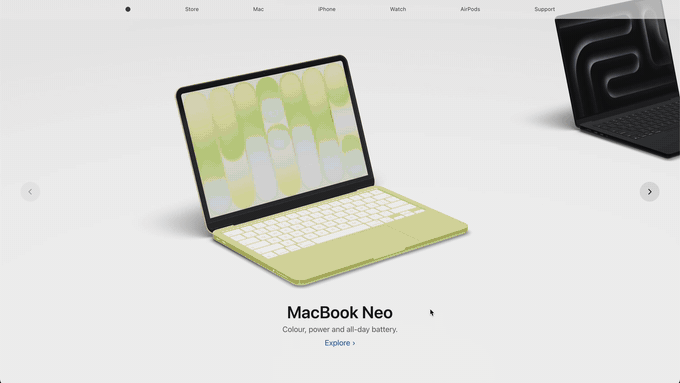
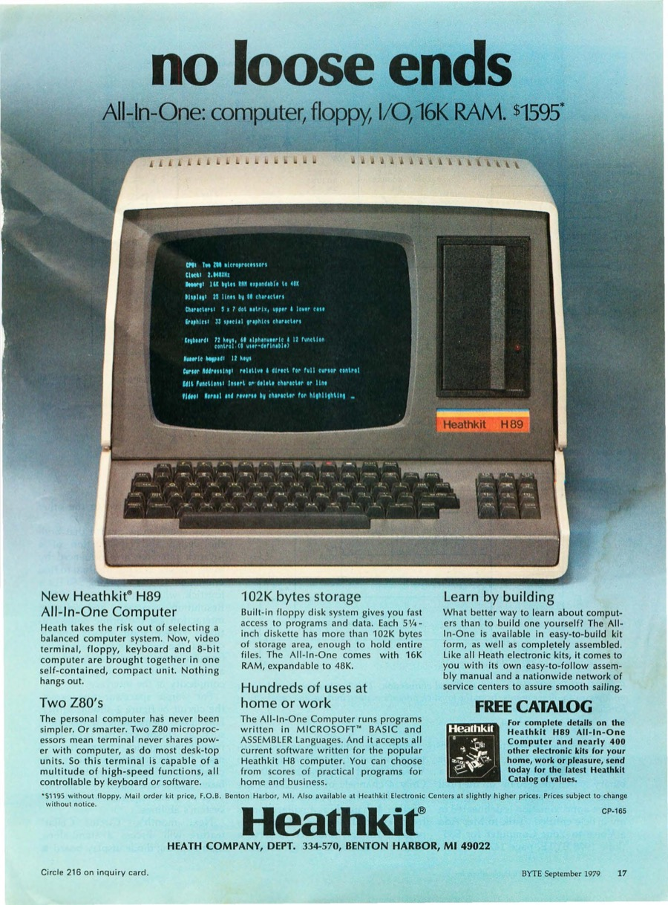
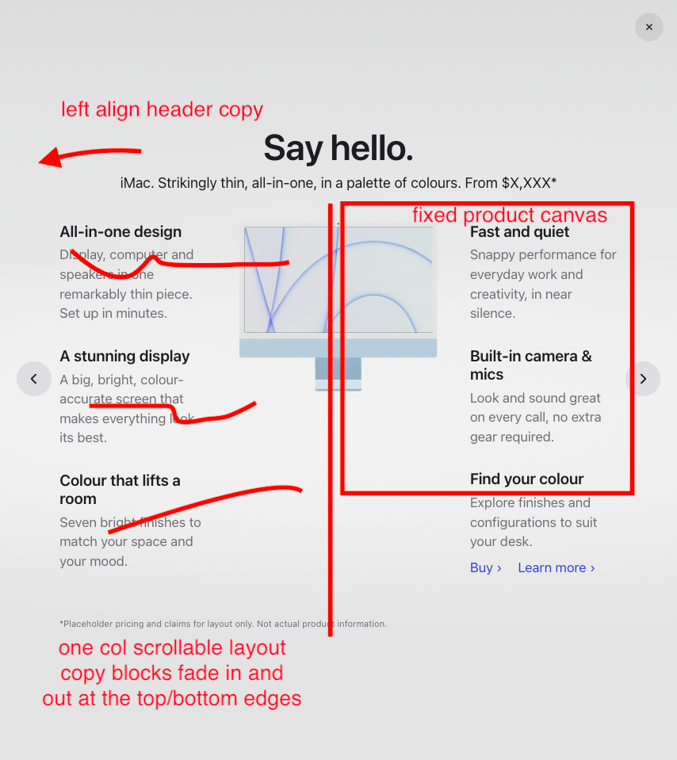

# 3D product carousel

**Live demo: https://benkimo6i.github.io/3d-product-carousel/**



A scroll-driven 3D product carousel that pairs a vintage print-ad layout with a modern product-page
look. Scroll or swipe through the lineup, open any product for an editorial details view, and drag to
turn it in your hands. It's an experiment in where web UI might be heading: composed rather than
templated, with the product itself as the interface.

Product names and copy are placeholders; not affiliated with Apple.

## Features

- **Scrub-and-snap carousel**: scrolling or swiping moves the row directly; let go near a product
  and it glides into place.
- **Details view**: the camera arcs around to a front-on view with headline and copy laid out around
  the product. Drag to rotate it freely; on release it settles into the nearest good angle.
- **Switch products in place**: step to the next product without leaving the details view.
- **Screens that wake up**: click a Mac or the iPhone in the details view and its wallpaper gives way
  to a mock desktop: creative apps on the Pros and iMac (design tool, photo editor, video editor),
  everyday apps on the Neo and iPhone.
- **MacBook Pro 14"/16" toggle**: the open lid closes, the machines crossfade and the other lid
  opens, shown at their real relative sizes.
- **Responsive layouts**: a three-column print-ad layout on desktop, product beside a scrolling copy
  column on tablets, and a stacked layout on phones.
- **Accessible**: keyboard and screen-reader friendly (details is a proper modal dialog), AA
  contrast, and reduced-motion support.

### Controls

| | Carousel | Details view |
|---|---|---|
| Scroll / swipe | Scrub the row (vertical or sideways); snaps when you stop near a product | Scroll the copy; swipe sideways to switch products |
| Paddles ‹ › | One product left or right | Previous / next product |
| Click a product or **Explore** | Open its details | Macs and iPhone: show or hide the mock desktop |
| Drag | — | Rotate the product |
| Keyboard | Tab to the paddles and Explore | ← / → switch products, Esc closes |

## Tech

React 19, [React Three Fiber](https://r3f.docs.pmnd.rs/) and [drei](https://drei.docs.pmnd.rs/) on
three.js, [GSAP](https://gsap.com/) (ScrollTrigger, ScrollTo) for scroll and timelines,
[zustand](https://zustand.docs.pmnd.rs/) for state, Vite and TypeScript. Models were prepared in
Blender and optimized with [glTF Transform](https://gltf-transform.dev/) and
[KTX-Software](https://github.com/KhronosGroup/KTX-Software).

### Why React Three Fiber

Compared with building it in plain three.js:

- **Organization**: the scene is components (`<Stage>`, `<Carousel>`, `<Product>`, `<CameraRig>`),
  each owning its own state and per-frame logic, alongside ordinary HTML/CSS for the copy and
  controls.
- **Scalability and flexibility**: the carousel is data-driven from a JSON manifest, and each product
  loads behind its own `Suspense` and error boundary, so models stream in independently and fail
  alone.
- **Performance**: rendering on demand is a single prop, and per-frame values live outside React,
  so animation never re-renders components.

### How it works

- **Scroll drives everything.** The page scroll is the carousel's single source of truth:
  ScrollTrigger maps it to a progress value that slides the product row. Snapping and the paddles
  just animate the page scroll.
- **One camera, two poses.** The camera orbits a target in spherical coordinates, so moving between
  the carousel and a details view is an arc around the product rather than a straight dolly.
- **Layout-driven framing.** The details layout is plain HTML/CSS. Each frame, the camera reads where
  the layout leaves room for the product, then sizes and shifts the shot to fit it, so the 3D
  product always sits in its slot at any screen size.
- **Render on demand.** The canvas only draws while something moves (scrolling, a tween, a drag),
  and nothing at all while idle, which saves battery on phones and laptops.
- **Lightweight assets.** Products stream in nearest-first; textures are KTX2 (they stay compressed
  on the GPU) and geometry is Meshopt-compressed. Soft floor shadows are baked in Blender rather than
  rendered live.

## How it was made

The idea grew out of conversations with colleagues about the future of web UI, and a vintage
computer print ad that showed me a way to bring it to life. I set the creative direction and designed
the experience (the look, the layouts and how it moves), and built it with Claude Code doing the
hands-on work under my direction. My background is in engineering, so MCP for Blender was what made
the 3D side possible: Claude drove Blender to build the scene under my direction, and then built the
web app in the codebase, checking every change in the browser along the way.

The [case study](docs/case-study.md) covers the art direction, the Blender setup, why React Three
Fiber, how we debugged it, and where I think this way of working is heading.

<table>
  <tr>
    <td width="50%" valign="top">
      <a href="docs/case-study.md#art-direction"></a>
      <br><sub><b>Art direction:</b> the details view takes its headline, centered product and
      editorial copy from a 1979 print ad. Heathkit H89 ad, Heath Company,
      <a href="https://archive.org/details/byte-magazine-1979-09/page/n18/mode/1up">BYTE, September 1979, p. 17</a> (scan via the Internet Archive).</sub>
    </td>
    <td width="50%" valign="top">
      <a href="docs/case-study.md#collaborating-and-debugging-with-claude"></a>
      <br><sub><b>Working with Claude:</b> annotated screenshots like this one directed each layout
      change.</sub>
    </td>
  </tr>
</table>

## Develop

```sh
npm install
npm run dev
```

## Models

`public/models/` holds the web-ready models (KTX2 textures, Meshopt geometry). They're built from
lossless Blender exports by `npm run optimize` (`scripts/optimize-models.mjs`), which needs
[KTX-Software](https://github.com/KhronosGroup/KTX-Software/releases) 4.x installed. The Blender
sources aren't part of this repo.

## Screens

The mock desktops shown on the Mac and iPhone screens are original placeholder UI, laid out in
`screens/desktop.html` over each device's own wallpaper. `npm run screens` renders them to
`public/screens/` with headless Chrome (set `CHROME` if it isn't in the default macOS location).

## Deploy

- Pushes to `main` publish to GitHub Pages (`.github/workflows/deploy.yml`).
- Every pull request gets a preview at `…/pr-preview/pr-<number>/`, linked in a PR comment
  (`.github/workflows/preview.yml`).

## Credits & licenses

3D models from Sketchfab, used under their creators' licenses (reshaded and optimized for this
demo):

| Model | Author | License |
|---|---|---|
| [MacBook Neo](https://sketchfab.com/3d-models/macbook-neo-f3dd26684f114b1baffd1b0800876627) | Ranguel | [CC BY 4.0](https://creativecommons.org/licenses/by/4.0/) |
| [MacBook Pro 14-inch M5](https://sketchfab.com/3d-models/macbook-pro-14-inch-m5-652a992f4f244122ae251f9cbb81da1e) | Apple User | Sketchfab Free Standard |
| [MacBook Pro M3 16-inch 2024](https://sketchfab.com/3d-models/macbook-pro-m3-16-inch-2024-8e34fc2b303144f78490007d91ff57c4) | jackbaeten | [CC BY 4.0](https://creativecommons.org/licenses/by/4.0/) |
| [iMac 2021](https://sketchfab.com/3d-models/imac-2021-304cb06ffb554883a7a642b2b56754c1) | DatSketch | [CC BY 4.0](https://creativecommons.org/licenses/by/4.0/) |
| [iPhone 17 Pro](https://sketchfab.com/3d-models/iphone-17-pro-4541aa8a28324b33a2baaf81d263aaec) | Ranguel | [CC BY 4.0](https://creativecommons.org/licenses/by/4.0/) |
| [Apple Watch Ultra 2](https://sketchfab.com/3d-models/apple-watch-ultra-2-f33263c457664b43909200c5ed5e6fa2) | polyman Studio | [CC BY 4.0](https://creativecommons.org/licenses/by/4.0/) |
| [AirPods (3e génération)](https://sketchfab.com/3d-models/ed331e742ab944e683dcddd59ab0713e) | polyman Studio | [CC BY 4.0](https://creativecommons.org/licenses/by/4.0/) |

The code is released under the [MIT License](LICENSE). The 3D models are not covered by it; they
remain under the licenses above. Product names are trademarks of their owners.
