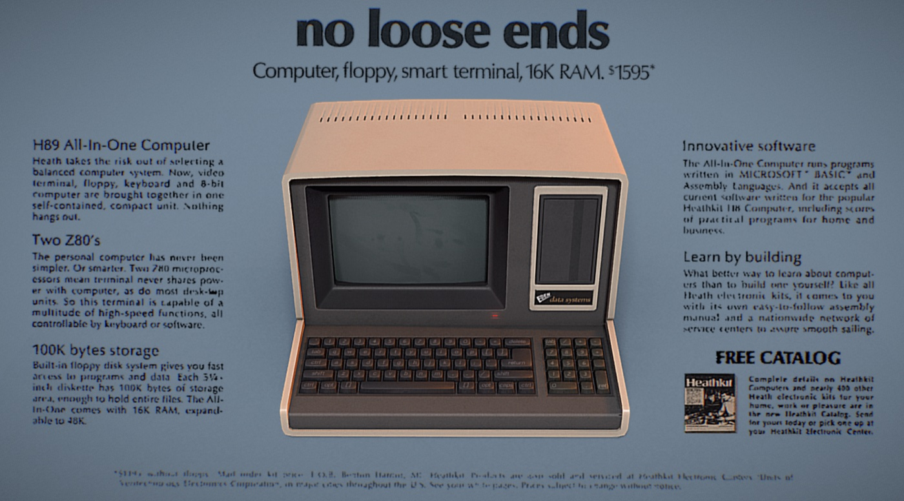

# Case study: a 3D product carousel

**Live demo: https://benkimo6i.github.io/3d-product-carousel/** · [Back to the README](../README.md)

I wanted a portfolio piece that felt like a modern product launch page, but with real 3D: a row of
products you scroll through, each one opening into a details view you can pick up and turn. I set
the creative direction and designed the experience (the look, the layouts and how it moves), and
built it with Claude Code doing the hands-on work under my direction, first in Blender (through MCP
for Blender) to set up the scene, then in the codebase for the web build.

This is how it came together: the art direction, the Blender setup, why I built it on React Three
Fiber, and what working and debugging with Claude actually looked like.

## Art direction

Two references shaped the look.

**Modern Apple product pages** set the tone for the carousel: a quiet light-grey stage, big confident
type, one product in focus with its neighbours peeking in at the edges, small round paddles, and
understated "Explore" links. Everything else stays out of the way of the product.

**A vintage computer print ad** set the layout of the details view. I loved how it puts the product
dead centre, front-on, with a huge headline above it and short copy blocks arranged around it in
columns, more like a magazine spread than a web page. The details view borrows exactly that
structure, rebuilt in a modern style: no blue-grey paper or period type, just the composition.

  
   
  Layout reference: Heathkit H89 All-In-One Computer advertisement, Heath Company (c. 1979).

A few decisions followed from those references:

- **One consistent set.** The products come from different Sketchfab artists, so they were reshaded
  with a shared material library (finishes, glass, satin and matte blacks, emissive screens) so they
  read as one family under one light.
- **Normalised sizes.** A Watch next to an iMac at real scale would be a speck. Every product is
  scaled to fill about the same space on the stage, except the two MacBook Pros, which keep their
  real relative sizes because comparing them is the point of the toggle.
- **A fixed camera.** The carousel camera never moves between products; the row slides under it.
  That makes switching feel like a single continuous object rather than a sequence of shots.
- **Copy that frames the product.** Placeholder, Apple-style copy, written to the shape of the
  layout: a headline, a one-line subline and three short blocks a side.

## Setting up the scene: Claude + MCP for Blender

Before writing any web code I wanted the 3D assets right, so the first phase happened entirely in
Blender, driven by Claude through [MCP for Blender](https://mcp-for-blender.com/). I
described what I wanted, Claude wrote and ran the Blender Python, and showed me viewport renders to
review. Then I gave notes and we went again.

- **Importing and auditing.** I picked free models on Sketchfab. Claude imported them, put each in
  its own collection and reported the mesh, triangle and material counts, so we knew where the
  weight was (the MacBook Pro 14" alone was 164k triangles and 28 materials).
- **Reshading.** Claude built the shared material library and remapped every model to it, keeping
  only the textures that carry real detail: keycaps, the Watch band, speaker grilles. Screens became
  emission-only so they glow the same everywhere.
- **Layout, camera and light.** The products went into a row on a seamless sweep with a 70mm-style
  camera from the front-left (38° round, 22° down) and a soft key spotlight. I reviewed renders and
  adjusted spacing, the iPhone's lean and the MacBook pairing until the composition held.
- **Rigging the MacBooks.** Each MacBook's lid was split into its own part with a hinge pivot, and
  the hinge angles were checked through the full swing so the lid never dips into the keyboard.
  That's what makes the close-swap-open toggle possible on the web.
- **Web-ready exports.** Every product was exported twice: a decimated carousel version (about
  20–40k triangles) and a full-detail version that only loads for the details view. Cameras, slot
  spacing and per-product settings were written into a JSON manifest the web app reads.
- **Baked shadows.** Real-time shadows in three.js weren't behaving at this tiny scale, so Claude
  rendered soft floor shadows in Cycles with a shadow catcher, one per product (two for the
  MacBooks, open and closed), and the web app lays them on the floor as textures.

## Building it: why React Three Fiber

I chose [React Three Fiber](https://r3f.docs.pmnd.rs/) because this piece is half 3D scene and half
web page, and R3F lets both live in one React app. The 3D scene is declarative components (the
stage, the row, each product), drei handles the loaders and environment lighting, and all the copy,
labels and controls are ordinary HTML and CSS on top, which keeps them accessible, selectable and
responsive. GSAP handles scroll and timelines, and zustand holds the app state.

The decisions that shaped the architecture:

- **Scroll as the single source of truth.** GSAP's ScrollTrigger turns the page's scroll position
  into a progress value, and the row's position comes straight from it. Every way of moving
  (scrolling, swiping, the paddles, snapping) ends up as a change to the page scroll, so there's
  only ever one place the carousel's position can come from.
- **Per-frame values outside React.** Things that change every frame (progress, the details
  transition, lid angles) live in a plain mutable object that GSAP animates and the scene reads in
  `useFrame`, so nothing re-renders React sixty times a second. React state is kept for the slower
  things: which product is open, which copy is showing.
- **One camera, two poses.** The camera orbits its target in spherical coordinates, so going from the
  carousel to a details view is an arc around the product, and switching products inside details
  slides the row while the camera holds its front-on view.
- **Layout-driven framing.** The details layout is real HTML/CSS with an empty slot where the
  product goes. The camera measures that slot and the product's actual silhouette, then sizes and
  shifts the shot to fit it. Restyling the layout at any breakpoint just works, and the 3D product
  follows.
- **Performance by default.** The canvas renders on demand (nothing at all while idle), off-screen
  products are skipped, phones render at a capped pixel ratio, products stream in nearest-first, and
  shaders are compiled when each model loads rather than the first time it appears.
- **An asset pipeline, not hand edits.** The Blender exports stay lossless; one script
  (`npm run optimize`) dedups and merges materials, resizes textures by role, encodes them as KTX2
  (which stays compressed on the GPU) and compresses geometry with Meshopt. Re-exporting from
  Blender and re-running the script is the whole update loop.

## Collaborating and debugging with Claude

The way we worked settled into a rhythm. I'd describe what I wanted, often as an annotated
screenshot, and Claude would ask clarifying questions before touching anything, then make the
change and verify it in a real browser (via Claude in Chrome) before handing it back: measuring
layout positions, sampling animations frame by frame, and running accessibility scans.

  
   
  My notes for the tablet layout: left-aligned header, one scrolling copy column, fixed product
  canvas.

Some of the bugs we tracked down along the way:

- **The product that wandered off on resize.** Resizing the window in the details view sometimes
  left the product off-centre. Reproducing it showed the scroll library recalculating positions
  after the page height changed and quietly moving the carousel to a different product. The fix
  remembers which product was open before the layout refresh and returns to it afterwards.
- **Scroll-jacking versus scrubbing.** The first carousel moved one product per scroll gesture. It
  worked, but kept needing special cases for trackpad momentum, fast flicks and sideways swipes.
  After trying a scrub mode, I preferred it: scrolling moves the row directly, and it only snaps
  when you stop close to a product. The paddles still step one product at a time.
- **The snap that fought back.** Sideways swipes felt like a tug-of-war. Simulating a swipe with
  small hesitations showed the snap starting during a 250ms pause mid-swipe, then being cancelled
  by the next movement, over and over. The snap now waits until there has been no input at all
  for 350ms.
- **Textures that wouldn't compress.** Normal maps came out barely smaller as KTX2. Inspecting the
  encoder commands showed the build tool silently dropping the compression-optimisation flags, so
  the pipeline now runs that encoding step directly with the right flags.
- **A stowaway in every model.** Every exported file was bigger than it should have been. A
  second scene used for baking shadows was being exported into every file, with its own copy of a
  laptop. One export setting (active scene only) fixed it.

## What I'd take away

- **Get the assets right first.** Doing the scene, materials, rigging and exports in Blender before
  any web code meant the web build started from a solid, consistent set rather than fighting seven
  different models.
- **Let the layout lead.** Making the 3D framing follow the HTML layout, rather than the other way
  round, made the responsive work far easier.
- **Verify in the real browser.** Most of the hard bugs only showed up with real scrolling, real
  timing or a real resize. Measuring them in the browser was what made them fixable.
- **Directing with AI works best with tight loops.** Clear references, annotated screenshots and
  questions answered up front, followed by small changes checked one at a time, kept the project
  moving without losing the design intent.
